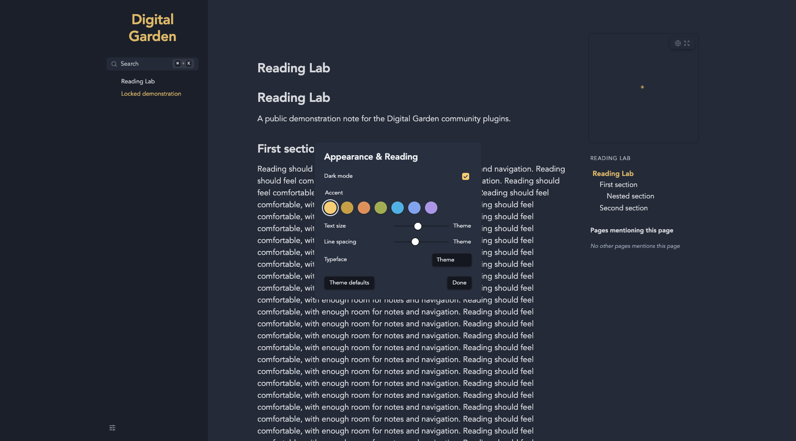

# Appearance & Reading

Theme-aware reading preferences and automatic high-resolution Easy TikZ graph publishing.

## Installation

In Obsidian: Settings > Digital Garden > Plugins > Manage plugins > Browse & install. Until listed in the community gallery, use Install from GitHub with `koltensaccount/garden-plugin-theme-toggle`. A garden with current plugin support is required. Installation is file copying only; no setup scripts or dependencies need to run on the garden. Save settings and let the site rebuild.

## Usage

The footer icon opens visitor preferences. Single-mode themes hide the mode switch, but reading preferences remain available. The Theme swatch matches the installed theme's link accent rather than its button color. Generated accent variations use relative OKLCH, retain a restrained chroma range and are adjusted to at least 4.5:1 against the primary theme background. Older browsers without relative colors keep Theme and Custom only. Button text chooses the higher-contrast black/white option. Reading width belongs to Resizable Panes, not this plugin. Preferences are browser-local and can be reset to theme defaults.

The last swatch opens the browser's native custom-color picker. Its exact color is saved with browser preferences when remembering preferences is enabled. Theme defaults restores theme styling without forgetting the custom color, so it can be selected again later. Custom colors are not automatically contrast-adjusted.

### Easy TikZ Publishing

Keep editing your graphs with Easy TikZ and publish your notes normally. During the garden build, Appearance renders `easy-tikz` fences into cached, transparent 4x PNGs and places them in the deployed site's image output. Nothing is inserted into your vault, and no export button, companion plugin, browser-side graph engine, TeX installation, remote rendering service or extra credentials are needed. Your editable graph source stays in the note. PNGs are generated at build time, not committed as extra image attachments to your source repository.

Light/dark image variants switch with the site's theme; print uses the light variant. Existing callouts and surrounding Markdown stay intact. Content-addressed filenames invalidate when a graph or export settings change; unchanged images reuse the build cache when available. First renders are slower than cache hits. The bundled engine targets Easy TikZ 4.6.0 text/JSON charts, including 2D and 3D, and JSON `tikz` fences. Raw LaTeX TikZ, custom editor vocabulary not stored in the block, sliders and interactive graph editing on the published site are not supported. Graph labels use bundled fonts and vector MathJax glyphs before rasterization, not the visitor's theme fonts. Colors use readable light/dark export palettes rather than sampling arbitrary theme CSS at build time.

Invalid chart source fails the new build with an explicit diagnostic rather than silently deploying a missing graph. Keep fenced blocks properly closed and retain the `>` prefixes inside callouts. Exports are limited to 128 KB source, 2400 CSS pixels per axis and 24 megapixels to bound build memory. Disable automatic graph publishing in the plugin manager to restore ordinary code-block output.

## Settings

| Key | Setting | Default |
| --- | --- | --- |
| `supportedModes` | Theme mode support | "auto" |
| `rememberMode` | Remember visitor mode | true |
| `rememberPreferences` | Remember reading preferences | true |
| `renderEasyTikz` | Automatically render Easy TikZ blocks during builds | true |
| `tikzScale` | PNG resolution multiplier, 2-4 | 4 |

## Compatibility and Accessibility

Works alone and with the other reading plugins. Shared footer controls use the neutral `dg-nav-tools` convention, with a floating fallback when navigation is absent. Each plugin ships the helper it needs; none imports another plugin. Current Digital Garden uses full-document navigation. Initialization is idempotent. Native controls, accessible labels, focus outlines and appropriate ARIA states are retained. Print styles remain separate from screen preferences. Browser storage failures fall back safely.

## Development

Node 22+; `npm ci`, `npm run check`, `npm test`. Tests use Node's test runner and Playwright's driver with an installed Chrome/Edge browser (`CHROME_PATH` overrides discovery). CI uses Ubuntu's Chrome. Browser tests never invoke an OS print dialog. The plugin files are ready to copy directly into `src/plugins/theme-toggle/` in a current test garden. Real upstream integration and combination checks are reported in `VALIDATION.md`.

The ready-to-copy `lib/` bundle includes the headless renderer, rasterizer, font and license notices. Garden installs do not run npm. To rebuild it, check out Easy TikZ commit `51c6a7c2b86d0a5b439191e0511518ea22b203bc`, set `EASY_TIKZ_SOURCE` to that directory and run `node scripts/build-tikz.cjs`. The Noto font and its OFL license are checked in. `build/tikz-*.js` contains the headless adapters. A focused installed-garden check is available as `CHROME_PATH=/path/to/chrome node scripts/verify-tikz-garden.cjs /path/to/test-garden`; it expects the synthetic `tikz-integration` page described in validation.

`compat/easy-tikz-4.6-callout-save.patch` is a separate, tested local compatibility patch for Easy TikZ's graph-saving bug inside callouts. It preserves quote/fence syntax and refuses stale or ambiguous replacements instead of inserting into the current selection. The patch is not injected by Appearance and is not an upstream Easy TikZ release; applying it requires rebuilding Easy TikZ. Plugin updates may overwrite a locally patched Obsidian installation.

## License

MIT, copyright 2026 Kolten Bendickson.
